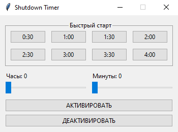

# Shutdown Timer


Утилита с открытым исходным кодом для отложенного выключения компьютера. Использует встроенную команду Windows `shutdown`



## Возможности

- Готовые пресеты от 30 минут до 4 часов
- Отдельные ползунки для часов (0-23) и минут (0-59)
- Отмена запланированного выключения одной кнопкой

## Системные требования

- 🖥️ Windows 10<br/>
- 🐍 Python 3.7+

> [!WARNING]
> Linux и macOS не поддерживаются

## Установка и запуск

Клонируйте репозиторий

```bash
git clone https://github.com/lezhebokin/shutdown-timer.git
```

> [!NOTE]
> Внешних зависимостей нет — используется только стандартная библиотека Python

Перейдите в его директорию

```bash
cd shutdown-timer
```

Запустите программу

```bash
python main.py
```

## Использование

1. Выберите один из пресетов в блоке «Быстрый старт» **или** задайте свое время ползунками «Часы» и «Минуты»
2. Нажмите «АКТИВИРОВАТЬ» и компьютер выключится через указанное время
3. Чтобы отменить запланированное выключение — нажмите «ДЕАКТИВИРОВАТЬ»

> [!WARNING]
> Кнопка «ДЕАКТИВИРОВАТЬ» отменяет любой активный таймер выключения Windows, не только запущенный этой программой

## Сборка исполняемого файла

Создайте виртуальное окружение

```bash
python -m venv .venv
```

Активируйте его

```bash
.venv\Scripts\activate
```

Установите модуль PyInstaller

```bash
pip install pyinstaller
```

Выполните в корне проекта

```bash
pyinstaller --clean --noconsole --onedir --name shutdown-timer --contents-directory library main.py
```

После сборки в директории `dist\shutdown-timer` появятся исполняемый файл и все необходимые зависимости

## Лицензия

Проект распространяется под лицензией [BSD-3-Clause](https://github.com/lezhebokin/shutdown-timer/blob/main/LICENSE)
